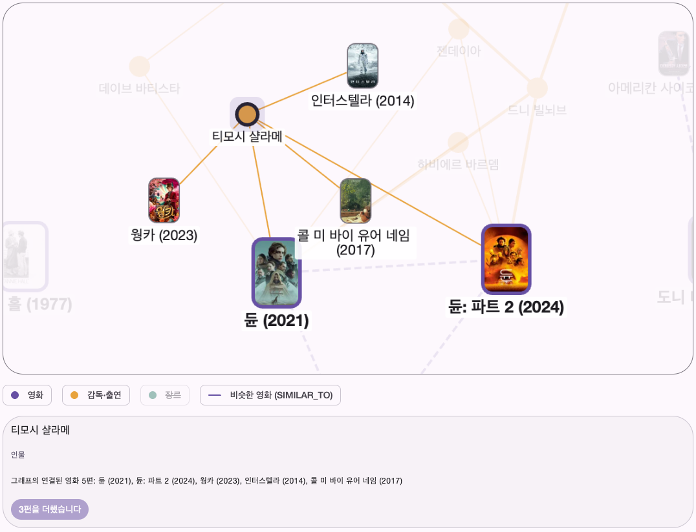
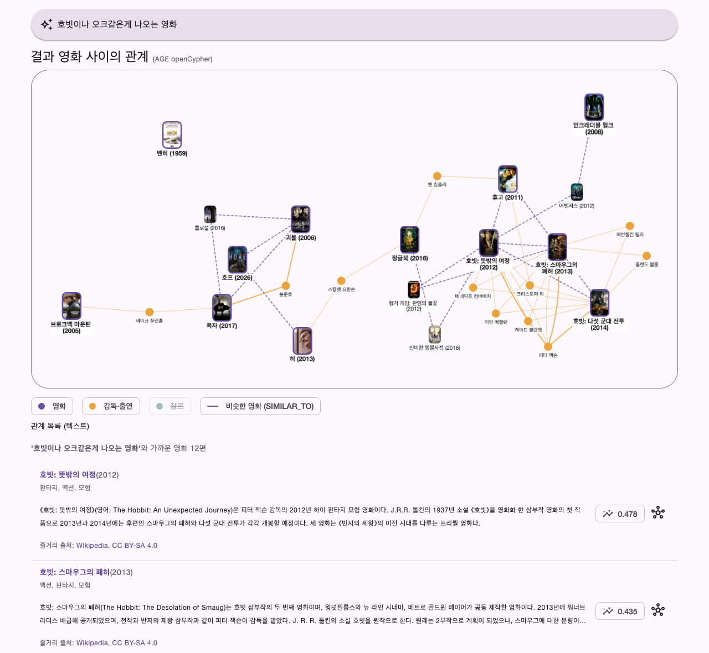

# MovieLog on Azure HorizonDB · 샘플 레포

> [!IMPORTANT]
> **문서 실습용 샘플 레포입니다.** [devguidesample](https://github.com/hellices/devguidesample)의
> [Azure HorizonDB 벡터 검색과 Apache AGE 그래프 — AKS MovieLog 의미 검색](https://hellices.github.io/devguidesample/services/azure-horizondb/movielog-graph-vector/)
> 문서를 재현하려고 만든 코드입니다. 구조와 측정 결과는 문서에서 설명하며, 운영 환경에 그대로 쓰도록 만든 코드가 아닙니다.

영화 리뷰 앱 **MovieLog**의 DB를 Azure HorizonDB로 바꾸고, 영화 카탈로그를 **의미로 검색**하고
**그래프로 탐색**하게 만든 예제입니다.



## 예제 범위

- **의미 검색** — 영화 문서와 질의를 Azure OpenAI `text-embedding-3-large`로 임베딩하고, pgvector·DiskANN
  벡터 순위와 키워드 순위를 RRF로 합칩니다. 인물·제목의 철자 오류도 교정합니다.
- **영화 그래프** — 같은 카탈로그를 Apache AGE 그래프(감독·배우·장르·비슷한 영화)로 만들어 Cytoscape.js로
  그립니다. 원본이 바뀌면 trigger queue로 바뀐 영화만 그래프에 반영합니다.
- **관측** — AKS 자동 계측(Application Insights Java agent)과 Micrometer 지표를 Managed Grafana로 봅니다.
- **로그인** — 아이디·비밀번호 로그인과 Microsoft Entra ID 로그인을 함께 지원합니다.

## 기술 구성

| 영역 | 사용 기술 |
|---|---|
| 앱 | Spring Boot 4.1.2, Java 25, Thymeleaf, Gradle Kotlin DSL |
| DB | Azure HorizonDB(PostgreSQL 17, 미리 보기), `vector`·`pg_diskann`·`age` 확장 |
| 임베딩 | Azure OpenAI `text-embedding-3-large`(1,536차원, Microsoft Entra 인증) |
| 실행 환경 | AKS, Application Gateway for Containers, cert-manager, Key Vault CSI driver |
| 관측 | Application Insights, Azure Managed Grafana |
| 데이터 | Wikidata·Wikipedia 영화 약 480편, TMDB 포스터 |
| 이미지 | `ghcr.io/hellices/sample-movielog-horizondb:<version>`(공개, build provenance 포함) |

## 레포 구성

| 경로 | 내용 |
|---|---|
| `src/` | 앱 소스. 검색·그래프는 `discover/`, Entra ID 로그인은 `member/`·`config/` |
| `db/` | DB, schema, 벡터 index, 그래프 생성과 동기화 SQL(`00` → `40` 순서) |
| `data/` | 카탈로그 빌더, TMDB 보강, 문서 임베딩 스크립트(Python 표준 라이브러리) |
| `k8s/` | namespace, 자동 계측, 앱, Key Vault secret, HTTPS 공개, 부하 manifest |
| `loadgen/`, `grafana/` | 합성 사용자 부하, Grafana 대시보드 JSON |
| `agent-init/` | Application Insights Java agent 3.7.10 init image |
| `docs/` | [배포 절차](docs/deploy.md), [설계 메모](docs/design-notes.md) |
| `.github/workflows/` | `ci.yml`(테스트·이미지 빌드 확인), `release.yml`(태그 → GHCR 게시) |

## 로컬 테스트

JDK 25가 필요합니다. 테스트는 H2 DB로 실행하므로 Azure 리소스가 없어도 됩니다.

```bash
./gradlew test
```

## Azure 배포 흐름

약 90분이 걸리고 유료 자원을 씁니다. 명령 전체는 [docs/deploy.md](docs/deploy.md)에 있습니다.

1. HorizonDB cluster와 pool을 만들고 parameter group으로 `vector`·`pg_diskann`·`age`를 허용합니다.
2. Azure OpenAI, AKS, ACR, Application Insights, Managed Grafana와 workload identity를 만듭니다.
3. DB를 준비하고 Key Vault 비밀값과 Microsoft Entra ID 앱을 등록합니다.
4. 릴리스 이미지를 `az acr import`로 ACR에 복사하고 AKS에 배포합니다.
5. 카탈로그를 적재하고 임베딩, 벡터 index, 그래프를 만듭니다.
6. Application Gateway for Containers와 cert-manager로 HTTPS를 열고 Grafana 대시보드를 올립니다.

## 화면과 API



| 경로 | 내용 |
|---|---|
| `/discover?q=` | 질의를 임베딩해 가까운 영화 12편과, 그 영화들을 잇는 인물·장르·`SIMILAR_TO` 그래프를 보여 줍니다. |
| `/graph/movies/{tmdbId}` | 영화의 감독·배우·장르·`SIMILAR_TO` 이웃과 같은 인물의 다른 영화를 그립니다. 영화 노드를 두 번 누르면 이동합니다. |
| `/movies/{tmdbId}` | 기존 상세 화면에 임베딩이 비슷한 영화 6편과 그래프 링크를 더했습니다. |
| `GET /api/discover/search?q=&limit=` | 의미 검색 결과(코사인 유사도 포함). 요청률 한도를 넘으면 429 |
| `GET /api/discover/movies/{tmdbId}/similar` | 임베딩 최근접 영화 |
| `GET /api/discover/graph/movies/{tmdbId}` | 영화 주변 그래프(Cytoscape 형식 node·edge, 영화 노드의 `posterUrl`, 인물 노드의 `qid`) |
| `GET /api/discover/graph/people/{qid}` | 인물과 그 인물이 감독·출연한 영화(최대 30편). `qid`는 `Q숫자` 또는 `tmdb:숫자` |
| `GET /api/discover/graph?ids=` | 주어진 영화들 사이의 연결 그래프 |

## 릴리스 절차

1. 변경을 PR로 `main`에 merge합니다. PR마다 CI와 Copilot 코드 리뷰를 거칩니다.
2. `git tag vX.Y.Z && git push origin vX.Y.Z`로 태그를 올리면 release workflow가 이미지를 GHCR에 게시합니다.
3. workflow 요약의 `ref`, `commit`, `image` 값을 문서 레포 `sample.yml`에 옮기고 submodule을 같은 commit으로 맞춥니다.

## 데이터 출처

카탈로그 구조는 [Wikidata](https://www.wikidata.org/)(CC0), 요약은
[Wikipedia](https://www.wikipedia.org/)([CC BY-SA 4.0](https://creativecommons.org/licenses/by-sa/4.0/))에서
가져옵니다. 화면에 보이는 요약은 출처 URL과 함께 `catalog.movie_docs.overview`에도 저장하고,
검색 결과와 영화 상세 화면은 그 요약 아래에 원문 Wikipedia 문서 링크와 라이선스를 표시합니다.
TMDB 키를 설정해 앱이 `public.movies.overview`를 TMDB 줄거리로 갱신해도 출처 표시는 저장한 요약에만 붙습니다. 임베딩 문서에만 쓰는 영어 요약의 출처는 `catalog.movie_docs.summary_en_source`에 기록합니다.
생성된 `data/out/`은 커밋하지 않습니다.

## 공개 저장소 주의

실제 구독·테넌트 ID, 비밀, 내부 호스트명을 커밋하지 않습니다. secret scanning과 push protection을 켜 두었습니다.
