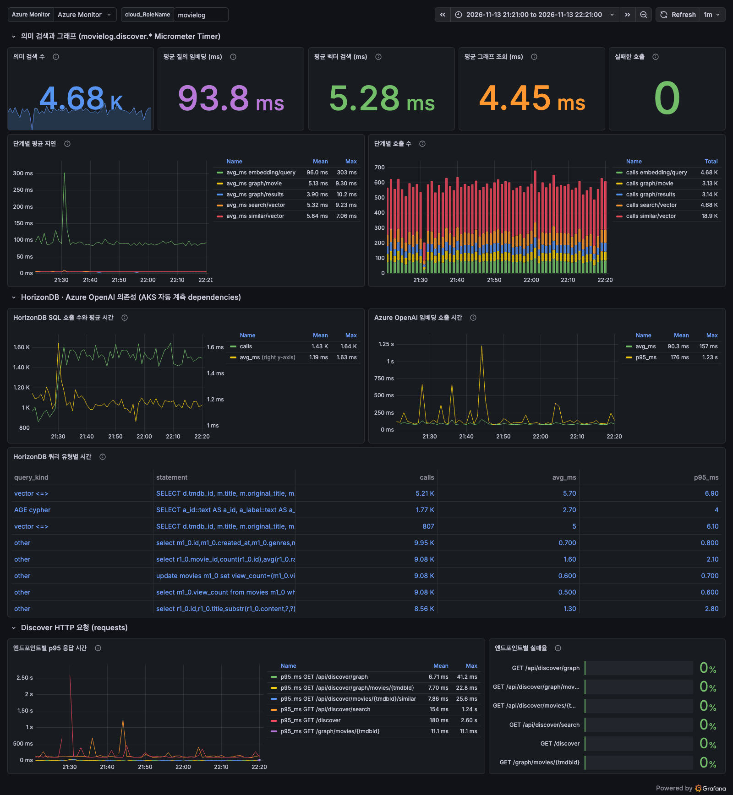

# Azure 배포 절차

[README](../README.md)의 배포를 Azure Developer CLI(`azd`)로 재현합니다. `azd up` 한 번으로 리소스를 만들고, 앱을
배포하고, 카탈로그를 적재하고, `azd down --purge`로 모두 지웁니다. HorizonDB·AKS(GPU spot 노드 포함)·Azure OpenAI·Managed Grafana를 쓰는
유료 실습이므로 끝나면 정리합니다.

## 준비물

| 항목 | 내용 |
|---|---|
| 권한 | 구독 Owner. Bicep이 역할을 할당하고 `preprovision`이 미리 보기 기능과 resource provider를 등록합니다. |
| 도구 | `azd`, Azure CLI 2.89 이상, `kubectl`, `envsubst`(gettext), `jq`, `psql` 15 이상, Python 3, `openssl`, `curl`. HTTPS를 쓰면 `helm`도 필요합니다. Azure CLI `horizondb`·`amg` 확장은 hook이 설치합니다. |
| 할당량 | 지역의 `standardDSv5Family` vCPU 8개, spot vCPU는 GPU 노드 크기의 vCPU 수만큼(기본 `Standard_NC4as_T4_v3`은 4개, `GPU_VM_SIZE`를 바꾸면 그 크기의 vCPU 수), Azure OpenAI `GlobalStandard` `text-embedding-3-large` 150K TPM. spot VM은 VM 계열과 상관없이 지역의 spot vCPU 할당량을 쓰므로 GPU 계열 할당량이 0이어도 만들 수 있습니다. |

## 환경 값

모두 선택 값입니다. `azd env set <이름> <값>`으로 넣고, TMDB 토큰처럼 저장하지 않을 값은 셸 환경 변수로만 넘깁니다.

| 이름 | 용도 |
|---|---|
| `APP_HOST` | 앱 공개 주소(예: `movielog.example.com`). 넣으면 Application Gateway for Containers와 Let's Encrypt로 HTTPS를 열고 Microsoft Entra ID 로그인 앱을 등록합니다. 없으면 `kubectl port-forward`로 접속합니다. |
| `DNS_ZONE_NAME`, `DNS_ZONE_RESOURCE_GROUP`, `DNS_ZONE_SUBSCRIPTION_ID` | `APP_HOST`가 속한 Azure DNS zone. 넣으면 hook이 CNAME을 만들고 `azd down` 때 지웁니다. 없으면 hook이 안내하는 CNAME을 직접 만듭니다. |
| `TMDB_API_TOKEN` | TMDB API Read Access Token. 셸 환경 변수로 넘기면 포스터를 채우고 앱의 TMDB 연동 키로 Key Vault에 넣습니다. |
| `OMDB_API_KEY` | Rotten Tomatoes 점수용 OMDb 키 |
| `ENABLE_LOADGEN` | `false`이면 부하 생성기를 배포하지 않습니다(기본 `true`). |
| `GATEWAY_ENABLED` | `false`이면 Gateway API와 AGFC add-on을 켜지 않습니다(기본 `true`). |
| `GPU_VM_SIZE` | 임베딩 서버용 spot GPU 노드 크기(기본 `Standard_NC4as_T4_v3`). `preprovision`이 지역에서 제공되는지 확인합니다. A10(`Standard_NV36ads_A10_v5`)이나 A100(`Standard_NC24ads_A100_v4`)이 제공되는 지역에서는 바꿔 쓸 수 있습니다. |
| `MOVIELOG_VERSION`, `APP_IMAGE_SOURCE`, `AGENT_IMAGE_SOURCE`, `VLLM_IMAGE_SOURCE` | 배포할 앱 버전과 이미지 위치. 기본값은 이 checkout의 릴리스 버전과 GHCR 이미지입니다. |

## 실행

```bash
azd auth login
az login                               # hooks use the Azure CLI
azd env new movielog --location koreacentral
azd env set APP_HOST movielog.example.com             # optional: HTTPS and Entra ID sign-in
azd env set DNS_ZONE_NAME example.com                 # optional: let the hook manage the CNAME
azd env set DNS_ZONE_RESOURCE_GROUP rg-dns
read -rs TMDB_API_TOKEN && export TMDB_API_TOKEN      # optional: posters
azd up
```

`azd deploy`는 `postdeploy`만 다시 실행해 이미지를 다시 가져오고 rollout합니다. 카탈로그가 이미 있으면 적재는
건너뜁니다.

## 단계별 동작

| 단계 | 파일 | 동작 |
|---|---|---|
| `preprovision` | `hooks/preprovision.sh` | 도구를 확인하고, `AzureMonitorAppMonitoringPreview`·`ManagedGatewayAPIPreview`·`ApplicationLoadBalancerPreview` 기능과 resource provider를 등록합니다. 운영자 공인 IP와 DB 비밀번호 두 개를 azd 환경(`.azure/<env>/.env`, 커밋하지 않음)에 둡니다. |
| provision | `infra/main.bicep`, `infra/resources.bicep` | resource group, Log Analytics, Application Insights, ACR, Azure OpenAI(키 인증 끔)와 임베딩 배포, AKS(workload identity, Key Vault CSI driver, Gateway API·AGFC, 애플리케이션 모니터링 자동 계측)와 NVIDIA GPU spot 노드 풀(AKS가 driver·device plugin·DCGM exporter를 관리), 앱 managed identity와 federated credential, Key Vault(공용 접근 끔), Managed Grafana와 역할 할당 |
| `postprovision` | `hooks/postprovision.sh` | HorizonDB parameter group·cluster·pool·관리자·방화벽, `movielog` DB와 schema, Key Vault private endpoint와 secret, Entra ID 앱 등록(`APP_HOST`), namespace·instrumentation·secret |
| `postdeploy` | `hooks/postdeploy.sh`, `hooks/https.sh` | GHCR 릴리스 이미지·agent init image·vLLM 이미지를 `az acr import`, GPU 노드에 vLLM(bge-m3-ko) 기동, Deployment 적용, 관리형 agent가 3.7.9 미만이면 3.7.10 init image로 전환, 첫 실행에서 카탈로그 적재와 두 모델의 임베딩·DiskANN index·AGE 그래프(비어 있는 bge 임베딩이 있으면 채운 뒤 그래프를 다시 만듦), replica 2개, 부하 생성기, Grafana dashboard, HTTPS(`APP_HOST`) |
| `predown` | `hooks/predown.sh` | resource group 밖에 만든 DNS 레코드와 Entra ID 앱 등록을 지웁니다. |

### HorizonDB를 hook으로 만드는 이유

Azure HorizonDB는 미리 보기이며 Bicep에 형식 정의가 없습니다(`BCP081`). 또한 pool을 만들 때는 기본 parameter
group만 받으므로 사용자 parameter group은 만든 뒤 따로 지정해야 하고, 관리자 인증 응답에는 `provisioningState`가
없을 수 있어 `administratorLogin`이 나타나는지로 완료를 확인합니다. 그래서 `postprovision`이 Azure CLI
`horizondb` 확장과 ARM REST API(`2026-10-01-preview`)로 만들고, 다시 실행해도 같은 결과가 되도록 있는 리소스는
건너뜁니다. HorizonDB는 다른 리소스와 같은 resource group에 있으므로 `azd down`이 함께 지웁니다.

### bge-m3-ko 임베딩 서버

`k8s/40-embeddings-vllm.yaml`은 vLLM OpenAI 호환 서버를 GPU spot 노드에 띄웁니다. 모델은 commit을 고정한
`dragonkue/BGE-m3-ko`이며 `--runner=pooling`, CLS pooling, `float16`(T4는 bfloat16 미지원)으로 실행합니다. 앱은
`EMBEDDINGS_BGE_URL`(클러스터 내부 Service)로 `/v1/embeddings`를 호출하고, `postdeploy`는 port-forward로
`data/embed_catalog.py --model bge`를 실행해 `catalog.movie_docs.embedding_bge vector(1024)`를 채웁니다.

| 항목 | 2026-11-15 실습 값 |
|---|---|
| 노드 | `Standard_NC4as_T4_v3` spot 1대(autoscaler min 1·max 1), taint `sku=gpu:NoSchedule` |
| 기동 | 노드 준비 뒤 이미지·모델 내려받기와 warm-up까지 약 6분 |
| 질의 1건 | 평균 약 0.1–0.2초(port-forward 경유 curl), 앱 Timer 평균 22 ms |
| 문서 479편 | 약 1분 30초(32건씩 배치) |

spot VM이 회수되면 autoscaler가 새 spot VM을 요청하고, 그 사이 `model=bge` 검색은 503을 돌려줍니다. 앱의
`EMBEDDING_DEFAULT_MODEL`을 `openai`로 바꾸면 Azure OpenAI로 계속 검색할 수 있습니다.

### Key Vault 접근

실습 구독은 Azure Policy가 Key Vault 공용 네트워크 접근을 끄므로 Bicep도 처음부터 끈 상태로 만들고,
`postprovision`이 AKS 관리형 VNet에 private endpoint와 `privatelink.vaultcore.azure.net` private DNS zone을 둡니다.
운영자는 Key Vault data plane 대신 ARM `Microsoft.KeyVault/vaults/secrets`로 값을 넣습니다. 값이 없는 키는 빈
문자열로 두며 앱은 빈 키를 설정되지 않은 것으로 다룹니다.

## HTTPS와 Microsoft Entra ID 로그인

`APP_HOST`를 넣으면 회원 가입과 form login의 비밀번호와 session cookie가 평문으로 오가지 않도록 HTTP listener는
Let's Encrypt HTTP-01 challenge에만 응답하고 나머지 요청은 HTTPS로 301 redirect합니다.

- **NSG** — AKS 관리형 VNet의 `aks-appgateway` 서브넷 NSG가 association에 적용되므로 hook이 frontend 포트(TCP 80,
  443)만 Internet에서 허용합니다. 실습 구독에서는 모든 포트를 여는 규칙을 조직 보안 자동화가 약 25분 뒤 지웠고,
  포트를 지정한 규칙은 유지됐습니다.
- **인증서** — cert-manager(Gateway API 지원)가 발급하고 만료 전에 갱신합니다. 실습에서는 `Certificate` 적용 후 약
  45초 만에 발급됐습니다.
- **전달 헤더** — AGFC가 `x-forwarded-proto`를 넘기고 `aks` profile은 `server.forward-headers-strategy=native`를
  쓰므로 앱의 redirect와 Entra ID `redirect_uri`는 `https://` 주소가 되고 `JSESSIONID`·`XSRF-TOKEN` cookie에는
  `Secure`가 붙습니다. listener에 hostname을 지정했으므로 AGFC 기본 FQDN으로 들어온 요청은 404를 받습니다.
- **Entra ID 앱** — single-tenant 앱을 `movielog-<env>` 이름으로 등록하고 client secret(1년)을 Key Vault에 넣습니다.
  로그인 화면의 **Microsoft Entra ID로 로그인**은 `/oauth2/authorization/entra`에서 Entra ID authorize endpoint로
  넘어갑니다.
- **session 고정** — `RoutePolicy`의 `managed-cookie`가 `AGCAffinity` cookie로 로그인 session을 한 Pod에 묶습니다.

```bash
curl -sI "http://$APP_HOST/" | grep -iE '^HTTP|^location'     # 301 -> https://$APP_HOST/
curl -sv -o /dev/null "https://$APP_HOST/" 2>&1 | grep issuer # O=Let's Encrypt
curl -s -o /dev/null -w '%{redirect_url}\n' "https://$APP_HOST/oauth2/authorization/entra"
```

## Grafana dashboard



`postdeploy`가 `grafana/movielog-horizondb-dashboard.json`의 `appinsights` 변수에 Application Insights resource ID를
채운 사본을 올립니다.

| Micrometer meter | 종류 | tag |
|---|---|---|
| `movielog.discover.embedding` | Timer | `kind=query`, `model` = `bge`/`openai`, `outcome` |
| `movielog.discover.search`, `movielog.discover.similar` | Timer | `kind=vector`, `model`, `outcome` = `found`/`empty`/`error` |
| `movielog.discover.graph` | Timer | `kind` = `movie`/`results`, `outcome` |
| `movielog.discover.rejected` | Counter | 요청률 한도로 Azure OpenAI 호출 전에 거부한 의미 검색 |

## 운영 메모

- **에이전트 버전** — Micrometer 지표를 Application Insights로 보내려면 Java agent 3.7.9 이상이 필요합니다.
  관리형 주입이 더 낮으면 `postdeploy`가 `k8s/21-agent-3.7.10.patch.yaml`의 두 단계로 3.7.10 init image로 바꿉니다.
  바꾼 뒤의 재배포는 이미지만 바꾸므로 manifest의 다른 변경을 반영하려면 주석의 `kubectl replace` 절차를 따릅니다.
- **schema 변경** — 이미 실행 중인 앱을 새 entity 열이 있는 이미지로 바꾸면 Hibernate `ddl-auto=update`가 열을
  더하는 순간 이전 Pod의 INSERT가 `cached plan must not change result type`으로 약 1초 동안 실패할 수 있습니다.
- **클러스터 자동 중지** — 실습 구독에서는 조직 자동화가 자정 무렵 AKS를 중지했습니다. 다시 볼 때는
  `az aks start`로 시작합니다.

## 정리

```bash
azd down --purge
```

`predown`이 DNS 레코드와 Entra ID 앱 등록을 지운 뒤 azd가 resource group을 지우고, `--purge`가 soft-delete된
Key Vault와 Azure OpenAI 계정을 영구 삭제합니다.
